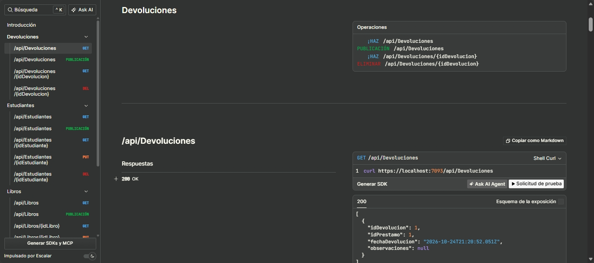
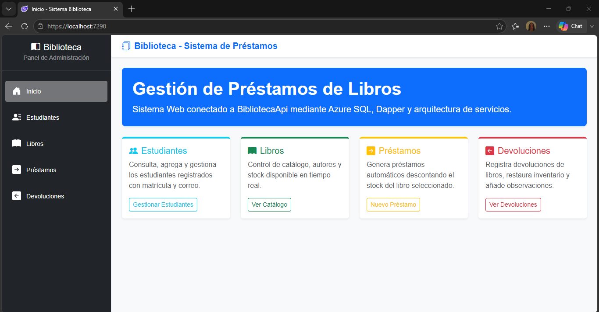
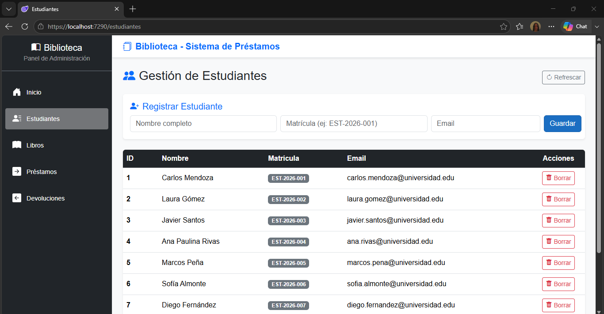
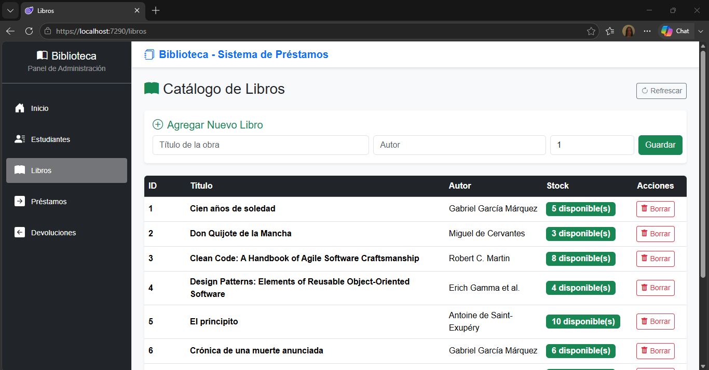
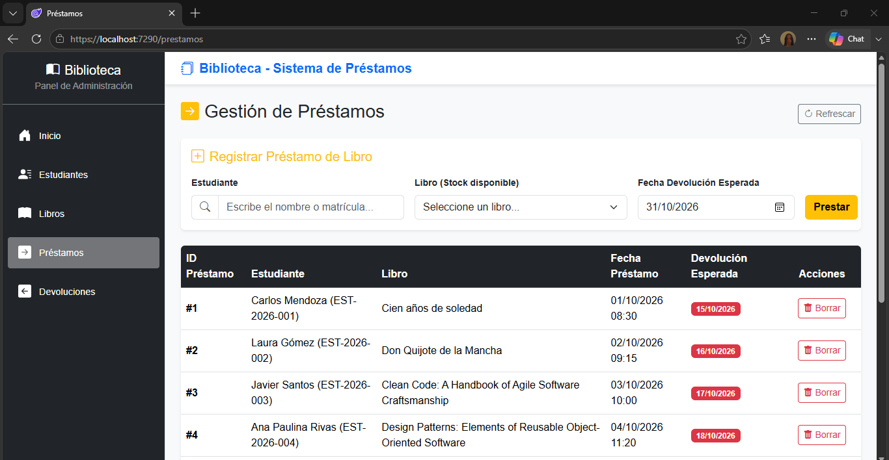
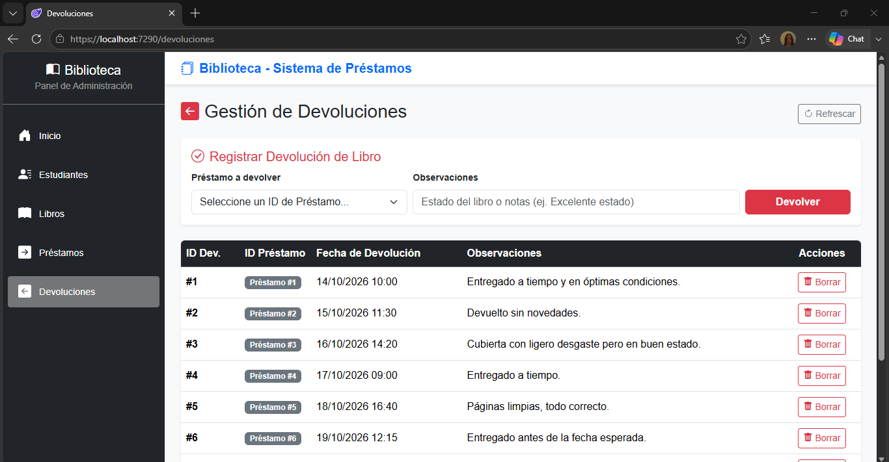

# 📚 BibliotecaApi

API REST para la gestión de una biblioteca universitaria (Estudiantes, Libros, Préstamos y Devoluciones), con un cliente web construido en **Blazor WebAssembly**.


---

## 📖 Descripción

`BibliotecaApi` expone un CRUD completo sobre cuatro entidades:

| Entidad | Descripción |
|---|---|
| **Estudiantes** | Alumnos registrados en el sistema |
| **Libros** | Catálogo con título, autor y stock disponible |
| **Préstamos** | Relación entre un estudiante y un libro, con fecha de préstamo y fecha esperada de devolución |
| **Devoluciones** | Registro de la devolución de un préstamo, con observaciones |

El acceso a datos se hace con **Dapper** sobre **Azure SQL Database**, el logging con **Serilog**, y la documentación interactiva de la API con **Scalar**.

El cliente `BlazorClient` (Blazor WebAssembly) consume la API y ofrece una vista por cada entidad.

## 📸 Capturas

| Vista | Captura |
|---|---|
| Documentación de la API (Scalar) |  |
| Blazor Client Inicio |  |
| Listado de Estudiantes |  |
| Listado de Libros |  |
| Préstamos |  |
| Devoluciones |  |


## 🧱 Estructura del proyecto

```
BibliotecaApi/
├── Controllers/          # Endpoints (Estudiantes, Libros, Prestamos, Devoluciones)
├── Services/              # Acceso a datos con Dapper
├── Models/                # Records *Get / *Set por entidad
├── Program.cs             # Configuración de la app (CORS, Serilog, Scalar, DI)
├── SQLQuery.sql            # Script de creación y carga de la base de datos
├── appsettings.json
├── BlazorClient/          # Cliente Blazor WebAssembly
│   ├── Pages/              # Un componente por entidad
│   ├── Layout/
│   ├── Models/
│   └── wwwroot/
└── docs/
    └── screenshots/        # Capturas usadas en este README
```

## 🛠️ Tecnologías

- **Backend:** .NET 10, ASP.NET Core Web API, Dapper, Microsoft.Data.SqlClient, Serilog, Scalar
- **Frontend:** Blazor WebAssembly (.NET 8), Bootstrap 5
- **Base de datos:** Azure SQL Database
- **CI/CD:** GitHub Actions → Azure App Service (Windows)

## 🔗 Endpoints principales

Todos los endpoints están bajo `api/[controller]` y devuelven/reciben JSON.

| Recurso | Verbos disponibles |
|---|---|
| `api/Estudiantes` | `GET`, `GET {id}`, `POST`, `PUT {id}`, `DELETE {id}` |
| `api/Libros` | `GET`, `GET {id}`, `POST`, `PUT {id}`, `DELETE {id}` |
| `api/Prestamos` | `GET`, `GET {id}`, `POST`, `DELETE {id}` |
| `api/Devoluciones` | `GET`, `GET {id}`, `POST`, `DELETE {id}` |

En desarrollo, la documentación interactiva está disponible en `/scalar/v1`.

## ⚙️ Configuración y ejecución local

### Requisitos

- [.NET SDK 10](https://dotnet.microsoft.com/download) (API) y SDK 8 (Blazor, incluido en el 10)
- Acceso a una instancia de Azure SQL Database (o SQL Server local)
- Visual Studio 2022 / VS Code

### 1. Base de datos

Ejecuta `SQLQuery.sql` contra tu instancia de Azure SQL / SQL Server. Crea las tablas `Estudiantes`, `Libros`, `Prestamos` y `Devoluciones`, y carga datos de ejemplo.

### 2. API (`BibliotecaApi`)

La cadena de conexión **no se guarda en el repositorio**. Configúrala con User Secrets:

```bash
cd BibliotecaApi
dotnet user-secrets init
dotnet user-secrets set "ConnectionStrings:AzureSQLConnection" "Data Source=<tu-servidor>.database.windows.net;Initial Catalog=BibliotecaDb;User ID=<usuario>;Password=<password>;TrustServerCertificate=True;"
dotnet run
```

La API levanta en `https://localhost:7093` (ver `Properties/launchSettings.json`).

### 3. Cliente (`BlazorClient`)

```bash
cd BlazorClient
dotnet run
```

El cliente levanta en `https://localhost:7290` y apunta a la API local (`https://localhost:7093`) cuando se ejecuta en modo Development.

## 🌐 CORS

La API habilita CORS únicamente para los orígenes del cliente Blazor (local y producción), configurados en `Program.cs`. Si cambias el puerto local del cliente o la URL del App Service del cliente en producción, actualiza la política `BlazorClientPolicy`.

## ☁️ Despliegue en Azure

- **API:** Azure App Service (Windows) + GitHub Actions, despliegue automático al hacer push a `main`.
- **Cliente Blazor:** Azure App Service (Windows) independiente, publicando el contenido de `wwwroot` tras `dotnet publish`.

La cadena de conexión de producción se configura como **Application Setting** en el App Service de la API (`ConnectionStrings__AzureSQLConnection`), nunca en el código fuente.